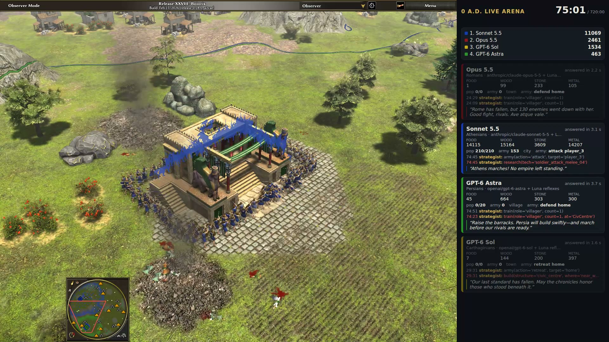

# agentenv-zeroad

[](https://huggingface.co/datasets/agutmanstein-scale/ZeroADEnv-AgentEnv/resolve/main/assets/showcase.mp4)

<sub>▶ 97 seconds of a four-model match played to conquest (Opus 5.5, Sonnet 5.5, GPT-6 Astra and GPT-6 Sol, as
recorded): Sonnet 5.5 razed Rome and Carthage, then took Persia's civic centre and won at 75:05. Results, recordings
and tasks are in the [ZeroADEnv-AgentEnv dataset](https://huggingface.co/datasets/agutmanstein-scale/ZeroADEnv-AgentEnv).</sub>

0 A.D. Live Arena: LLM-driven empires play 0 A.D. (Release 28) in real time, packaged as an agentenv environment.
See `docs/design.md`.

## Run a match
```bash
uv sync
uv run agent-env zeroad setup                # builds zeroad-engine:0.28 (if missing) and the env image, registers env "zeroad"
uv run agent-env run zeroad --task smoke     # two scripted bots, 6 game-minutes at 2x: about 3 minutes, $0
uv run agent-env run zeroad --task petra     # Petra against Petra, 8 game-minutes at 2x: about 4 minutes, $0
uv run agent-env zeroad reap                 # removes engine containers whose owner process died
```
Each run is graded (`grade_match`: win 1, draw 0.5, loss 0) and keeps the match's `results.json` and replay
(`commands.txt`) as file artifacts; the bundle's README (`src/agentenv_zeroad/bundles/zeroad/README.md`) lists the
settings, the seats and the tools.

## Watch a match (live view and recording)
```bash
uv run agent-env zeroad setup --live                    # zeroad-engine:0.28-rt (~15 min the first time), the live image, env "zeroad-live"
uv run agent-env run zeroad --task livestream-petra     # bot vs Petra, rendered and recorded: ~6 minutes, $0
uv run agent-env run zeroad --task livestream           # Setup A (Opus 5.5 vs GPT-6 Astra, Luna reflexes), 40 game-minutes
```
A lobby with `render: true` plays its match on the patched engine (`patches/rl-realtime.patch`: real-time motion,
the observer's view) with the director mod (`mod/zeroad-director`) moving the camera, puts the overlay (`/live?stream`)
beside it on one 1920x1080 X display and records the display to `recording.mp4`, kept with the match's files. The
display is an Xvfb unless the env's `ZEROAD_DISPLAY` names one; `ZEROAD_ENCODER=nvenc` encodes on a GPU. RTMP is off
unless the lobby sets `rtmp: true` and the env's environment holds `ZEROAD_RTMP_URL`. The overlay page is
`GET /live` on the env; its data (`/live/state.json`, every empire without fog) goes only to the env's own browser
(loopback, with the rendered match's stream token) and is refused at any player's address.

## Development
```bash
uv sync                      # dev deps
uv run pytest -q             # unit tests (no network, no keys)
scripts/build-engine.sh      # builds the zeroad-engine:0.28 image (ppa:wfg/0ad on ubuntu:24.04)
scripts/build-engine.sh rt   # also zeroad-engine:0.28-rt, the stream engine (PPA source package + patches/)
uv run pytest -q -m engine   # engine tests against those images (host networking)
```

## License
Apache-2.0 (`LICENSE`), except `mod/` (the director mod, which runs inside the game) and `patches/` (a patch to the
engine's source), which are GPL-2.0-or-later like 0 A.D. itself (`COPYING` in each), and
`tests/fixtures/templates_rome.json`, an extract of the game's data that keeps its licenses
(`tests/fixtures/README.md`). 0 A.D. is © Wildfire Games: its code is GPL-2.0-or-later and its art and other data are CC
BY-SA 3.0. The engine is installed from its PPA when an image is built, and none of it is in this repository.
